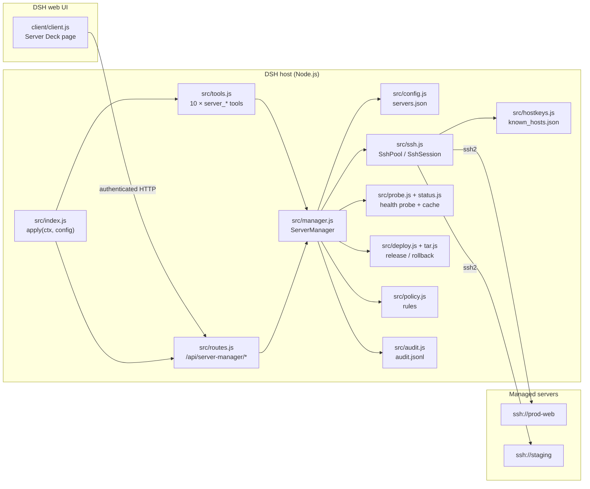
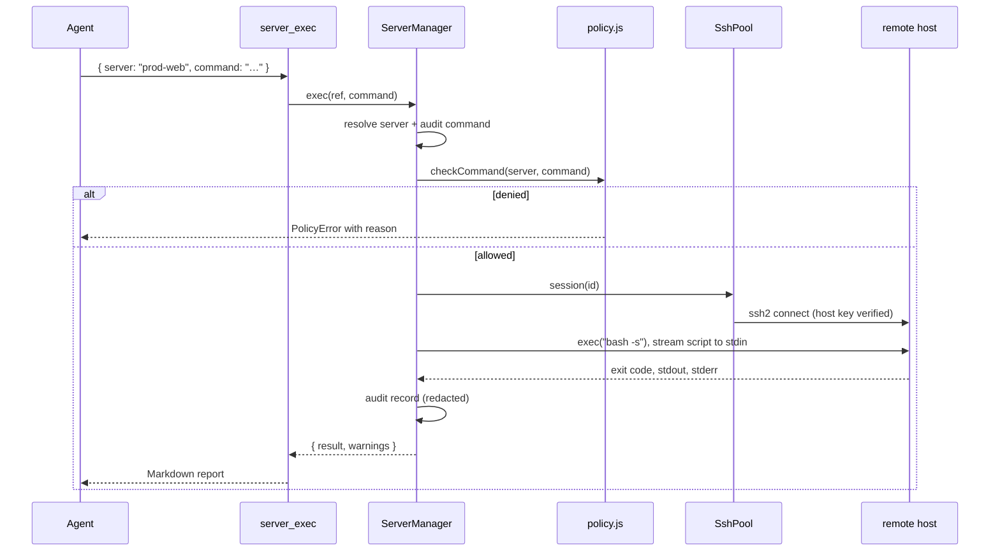
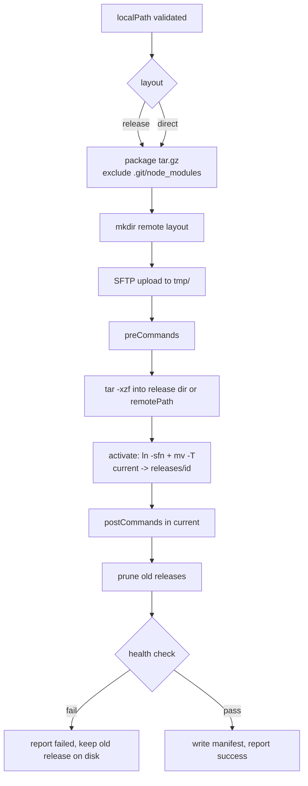

# Architecture

## Two halves, one configuration



The panel and the agent share `ServerManager`: same configuration, same connection pool, same
status cache, same policy. A probe started from the panel is visible to `server_list` immediately.

## Host half

`src/index.js` is a Cordis plugin:

```js
export const name = 'server-manager'
export const inject = []
export function apply(ctx, config) {
  const manager = new ServerManager({ config })
  ctx.effect(() => () => manager.dispose(), 'server-manager: dispose')
  ctx.effect(() => ctx.inject(['tools'], c => registerTools(c, manager)), '…')
  ctx.effect(() => ctx.inject(['webServer', 'connection'],
    c => registerRoutes(c, manager)), '…')
}
```

`ctx.inject` waits for a host service and returns a disposer; wrapping it in `ctx.effect` means
unloading the plugin unregisters every tool and route and closes sockets. The plugin has no
hard dependency at module scope, so it can load before `tools`/`webServer` exist (for example in
a headless profile).

### Module map

| File | Responsibility |
| --- | --- |
| `src/index.js` | Plugin entry, wiring, version, disposal. |
| `src/manager.js` | Facade used by tools and routes: config mutations, exec, transfer, probe, deploy, audit. |
| `src/config.js` | Parse/normalize/validate `servers.json`, public projection, legacy import, host-spec parsing. |
| `src/secrets.js` | Resolve `vault:` / `env:` / `file:` / `literal:` references, describe them, redact text. |
| `src/vault.js` | AES-256-GCM secret store; key file, atomic writes, encrypt/decrypt. |
| `src/policy.js` | Danger rules, allow/deny lists, capability checks. |
| `src/ssh.js` | `ssh2` connection pool, exec over `bash -s`, SFTP upload/download, timeouts, cancellation. |
| `src/vendor/ssh2.js` | Generated ESM bundle of `ssh2` and its dependencies (see below). |
| `src/hostkeys.js` | TOFU trust store and `SHA256:` labels. |
| `src/probe.js` | One-shot shell script and parser for system metrics. |
| `src/status.js` | Probe orchestration, cached status, bounded concurrency. |
| `src/tar.js` | Streaming ustar + gzip writer with glob exclusions. |
| `src/deploy.js` | Release/direct deploy, hooks, health, prune, manifest, rollback. |
| `src/format.js` | Markdown rendering for tool results. |
| `src/routes.js` | Authenticated JSON API for the panel. |
| `src/tools.js` | Tool schemas and handlers. |
| `icon.png` | Plugin logo used by DSH and the dashboard. |

## A tool call



### Connection reuse

`SshPool` keeps one `SshSession` per server id. Sessions connect lazily, multiplex exec and SFTP
calls, and are reaped after `idleTimeoutMs` (default 60 s, checked every 30 s). A closed or failed
session is forgotten so the next call reconnects.

`exec` is a single `bash -s` channel: the script is streamed to stdin and EOF closes it. This
avoids nested quoting entirely and makes multi-line scripts behave as written. `sudo` uses
`sudo -S -p '' bash -s`, writing the password line first.

Timeouts close the channel and return an `SshTimeoutError` carrying whatever output arrived.
`exec.signal` from the tool runtime is forwarded, so cancelling the agent stops the command.

### Host keys

`ssh2` is configured with `hostHash: 'sha256'`. The verifier is synchronous (SSH requires a
decision before authentication), so `HostKeyStore` reads/writes a small JSON file synchronously.
Unknown keys are recorded under `accept-new`; a changed key throws before authentication and the
connection is refused with a message containing both fingerprints.

## Status probe

One shell script prints `SM_KEY=value` lines. It is deliberately boring: `uname`, `/proc/stat`,
`/proc/meminfo`, `df -Pk`, `ps`, `docker ps`, `systemctl --failed`. Each block is guarded, so a
missing `docker` or a non-systemd host produces partial output instead of an error. CPU usage is
a 300 ms delta of `/proc/stat`; everything else is a snapshot.

`parseProbe` turns the lines into a stable object with derived percentages, warnings and a
`level` (`ok` / `warn` / `critical`). Unreachable hosts are stored as `{ reachable: false, error }`
so the panel can show "offline since …" without guessing.

## Deploy pipeline



The archive is built locally with a streaming ustar writer (`src/tar.js`), so a large project never
has to fit in memory. Exclusions are applied before reading file contents. Windows file modes are
normalized to 0644/0755 so an archive built on Windows extracts sensibly on Linux.

Activation uses `ln -sfn … .next && mv -Tf .next current` on GNU systems, with a `rm` + `mv`
fallback where `mv -T` is unavailable. There is a very short window between unlink and rename on
that fallback; nginx/systemd will see the old or the new directory, not a mix, because both are
complete before the switch.

A failed deploy keeps the previous `current` untouched. `server_rollback` reads the release
directory listing and `readlink current` to pick the previous entry.

## Docker and 1Panel

`src/docker.js` builds one shell script that prints prefixed lines (`SM_PS=`, `SM_LABELS=`,
`SM_STAT=`, `SM_LOG=`, `SM_ONEPANEL_*`) and parses them into a stable object. It never shells out
locally and never trusts container names: lifecycle actions are validated against
`[A-Za-z0-9][A-Za-z0-9_.-]*` before they are interpolated.

`docker ps` only works for users in the `docker` group. `ServerManager.runDocker` first runs the
script as the login user; when the daemon answers with a permission error and a `sudoPassword` is
known, it retries through `sudo -S`. `list` is cached for two seconds so the 5-second dashboard
poll does not stampede the host, while `refresh` bypasses the cache. The health probe also retries
`docker ps` through `sudo` so the fleet counters do not show zero containers.

Container links are derived from the `docker ps` `Ports` column, never guessed from an image name.
Published TCP bindings become `http(s)://<server-host>:<host-port>`; loopback-only bindings are
skipped, `443`/`8443` switch to HTTPS, and a compose service named `web`/`frontend` inherits its
project's proxy URL when it publishes no port of its own.

Compose upgrades read the `com.docker.compose.*` labels (`project`, `service`, `working_dir`,
`config_files`) and run `docker compose -f … pull <service> && … up -d <service>` in the working
directory. Both the directory and the service name are validated, and the call gets a 10-minute
timeout. A failed pull leaves the old container running.

1Panel is detected, not driven: the script reports `/opt/1panel` presence, `1pctl version`, the
listening port of `1panel-core`, and which containers live under 1Panel app directories. The deck
uses that for grouping and for the optional `onepanel.url` deep link. No 1Panel API is called, so
an IP allow-list or a changed entrance does not break container control.

The app-store board is a separate read-only path (`src/onepanel.js`). It opens
`/opt/1panel/db/agent.db` through SQLite’s `file:…?mode=ro` URI from `python3`, so nothing is
written. For each `app_installs` row it compares the installed `version` with the newest
`app_details` row for the same `app_id` (`ORDER BY id DESC LIMIT 1`); the `app_details.update`
column is not used because 1Panel sets it to 1 on historical rows too. The database is root-only,
so a login user without read access triggers one retry through `sudo -S`. Results are cached for
60 seconds and refreshed by the board’s own poll.

## Proxmox VE

`src/pve.js` reads the host through `pvesh get /nodes` and
`pvesh get /cluster/resources --output-format json`. Both replies are JSON on stdout and can
contain newlines, so the shell script base64-encodes each payload before printing it
(`SM_PVE_NODES_B64`, `SM_PVE_RESOURCES_B64`), and the parser decodes and validates the shape. A bad
or partial payload becomes a warning instead of a failed request.

The card is deliberately **read-only**: it lists VMs and containers with state, CPU, memory, disk
and uptime, plus node and storage capacity, and links to `https://<host>:8006`. Power actions stay
in the PVE console. `pve()` caches its result for five seconds and retries through `sudo` when
`pvesh` is not readable by the login user. No PVE API token is stored.

Update alerts reuse the same PVE connection. The script walks `pvesh get /nodes`, then runs
`pvesh get /nodes/<node>/apt/update --output-format json` for each node and merges the replies into
`SM_PVE_UPDATES_B64`; `parsePveOutput` exposes `updates`, `updateCount`, `securityCount` and
`updatesCheckedAt`. The list is only PVE’s cached apt state, so **Check updates** is an explicit
action (`POST /api/server-manager/pve` with `action: "refresh-updates"`) that runs
`pvesh create /nodes/<node>/apt/update` with a 180-second timeout. It is never part of the 30-second
poll, because `apt update` writes package lists and takes time.

## Client half

`client/client.js` is plain ESM consumed by the DSH web module loader (`window.__ModuleLoader__`).
It registers a first-class left-sidebar entry and a full main-pane page:

- an icon in the `sidebar.panellist` list slot (`id: "server-manager"`, `order: 6`), labelled
  **服务器监控管理** (Server Deck) — the same rail that hosts Plugins, Automation tasks and
  Self-media workspace;
- a `main` keyed-slot page (`key: "server-manager"`) rendered as `Dashboard`.

Selecting the rail icon activates the `main` page by the matching id. The page never assumes it is
the only entry; it fetches its own data and keeps its selection in `localStorage`.

No bundler, no build step. It uses `fetch('/api/server-manager/…')` with same-origin credentials
and renders with `React.createElement` from the host's React instance. Styling is a single
injected `<style>` scoped under `[data-server-manager]` and uses DSH theme CSS variables
(`--dsw-alias-*`) so it follows light/dark themes.

## Why ssh2 is bundled

DSH loads the host half through an SSR module runner that imports dependencies with an
ESM-oriented interop. `ssh2` is CommonJS and ends with `module.exports = Client`; under that
runner the class arrives as a namespace object, and `new Client()` fails with
`Client is not a constructor`. Loading it through `createRequire` does not help, because the
dependency graph has already been transformed.

`scripts/build-vendor.mjs` resolves this once, at build time: esbuild inlines `ssh2`, `asn1`,
`bcrypt-pbkdf` and `tweetnacl` into `src/vendor/ssh2.js`, converting each CJS module with the
correct interop. The banner re-creates `require`, `__dirname` and `__filename` for the parts of
ssh2 that use them (Node builtins and the emscripten poly1305 build), and stubs `cpu-features`, an
optional native accelerator that ssh2 calls inside a try/catch.

Consequences:

- The plugin has no runtime dependencies and no install scripts, so installing it cannot fail on a
  missing C++ toolchain.
- The bundle is committed (≈330 KiB, minified) and must be regenerated with `npm run build:vendor`
  when `ssh2` is upgraded.
- `test/vendor.test.js` asserts the bundle exports a constructible `Client` and that no source file
  imports `ssh2` directly.

## Design decisions

- **No config schema in Cordis.** The server list is user data, edited far more often than the
  plugin is configured; keeping it in a JSON file lets the panel and the agent share one writer
  without round-tripping through the loader.
- **Host key pinning by default.** A first-run warning would be ignored; a hard failure on change
  is the behaviour that actually protects people.
- **Policy in the manager, not the tools.** Every entry point (tools, routes, future callers) goes
  through the same `checkCommand` and audit path.
- **Text tool output.** The model needs to read status and diffs; Markdown tables are cheaper and
  more robust than schemas that change between versions.
